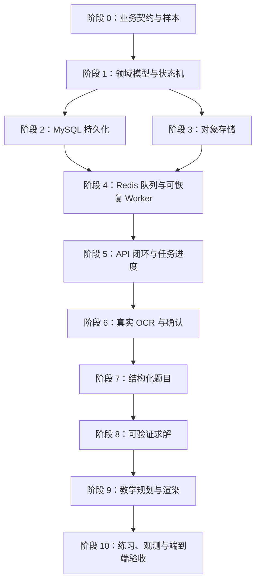

# 后端分阶段实现计划

版本：v1.0  
日期：2026-09-18  
依据：[BACKEND-ROADMAP-v2.md](./BACKEND-ROADMAP-v2.md)  
范围：后端与基础设施，不包含前端开发

## 1. 使用方式

本计划将后端路线拆成可以独立实现、独立验证、独立 Review 的阶段。每个阶段都要求：

1. 先明确用户价值和业务不变量；
2. 再实现最小范围；
3. 通过单元测试或集成测试验证；
4. 记录已知限制和下一阶段依赖；
5. Review 通过后再进入下一阶段。

阶段之间不建议混合提交。例如，MySQL Repository 的实现不应同时夹带真实 OCR、状态机重构和 API 错误响应改造，否则出现问题时无法判断责任边界。

## 2. 当前基线

当前已有：

- Go 模块化后端骨架；
- `Lesson` 基础领域模型；
- 内存 Repository、图片存储和任务队列；
- Demo OCR、结构化、求解、教学规划和渲染 Adapter；
- 创建 Lesson、查询 Lesson、低置信度确认、提交练习 API；
- 基础 Worker 流程与测试。

当前主要问题：

- 状态转换由 Worker 直接修改，缺少统一状态机；
- `QuestionDraft`、结构化题目和讲解结果没有版本关系；
- 内存存储无法支撑重启恢复和并发任务；
- Worker 没有真正的重试、超时、幂等消费和失败分类；
- 练习结果没有持久化，答案采用简单字符串比较；
- 当前模型字段不足以保存字段级置信度、求解证据和下一步操作。

## 3. 总体依赖关系



核心原则：在接入真实 OCR/LLM 前，必须先完成 Redis 队列和可恢复 Worker；否则真实模型调用无法稳定验证。

## 4. 阶段 0：业务契约、样本集和 Review 基线

### 目标

固定所有后续模块共同遵守的产品事实，避免先写基础设施、后反复修改数据结构。

### 实现范围

- 定义 `Lesson`、`QuestionDraft`、`QuestionVersion`、`StructuredQuestion`、`VerifiedSolution`、`LessonPlan`、`PracticeResult`；
- 定义状态和状态转换；
- 定义错误分类：用户输入错误、不可恢复业务失败、可重试外部失败、系统故障；
- 定义 `LessonPlan` JSON Schema；
- 定义四类视觉组件的参数约束；
- 定义 10～20 道典型五、六年级题目样本；
- 为样本标记预期题型、关键字段、标准答案和推荐讲解路径；
- 统一 MySQL、轮询、Redis 和对象存储的技术决策描述。

### 业务不变量

- 只有通过数学校验的结果才能进入 `ready`；
- 低置信度题目不能静默进入自动讲解；
- 用户修改题目后必须产生新版本；
- Lesson 当前状态和状态事件必须一致；
- LessonPlan 是完整结果的唯一事实来源，MVP 不同时维护 `lesson_steps`。

### Review 重点

- 数据模型是否能表达 OCR 原文、用户确认文本和结构化结果的版本关系？
- 失败后哪些状态允许重试，哪些状态必须重新创建 Lesson？
- 一个结构化题目是否同时满足求解、教学规划和渲染的输入要求？
- 样本集是否覆盖低置信度、单位、分数、超纲和无法验证场景？

### 通过标准

- 领域对象和状态转换表得到确认；
- JSON Schema 可以校验 Demo LessonPlan；
- 样本集可以作为后续回归测试输入；
- 后续阶段不再自行发明状态或结果字段。

## 5. 阶段 1：领域模型与统一状态机

### 目标

把当前 Worker 中的隐式状态修改，收敛为可测试、可持久化、可解释的领域能力。

### 状态

```text
created
  → recognizing
  → awaiting_confirmation
  → structuring
  → solving
  → planning
  → rendering
  → ready
```

异常路径：

```text
recognizing / structuring / solving / planning / rendering
  → failed
failed → 可重试阶段
awaiting_confirmation → rejected
```

### 实现范围

- 增加统一状态转换函数或状态机服务；
- 禁止 Worker 直接写入任意状态；
- 增加阶段、错误码、错误详情、重试次数、最后错误时间；
- 增加 `nextAction` 和用户可见阶段文案的映射；
- 明确确认题目后从 `structuring` 恢复，不重复 OCR；
- 为状态转换补充表格驱动测试。

### 不在本阶段做

- 不接 MySQL；
- 不接真实 OCR；
- 不重写完整 Worker；
- 不新增前端实时推送。

### Review 重点

- 状态转换是否有单一入口？
- 失败重试是否会绕过用户确认？
- `failed` 是否区分业务失败和基础设施失败？
- 状态名称是否能直接支撑前端进度展示和运营排障？

### 通过标准

- 所有非法转换都有明确错误；
- 状态机测试覆盖正常路径、低置信度路径、拒绝路径和失败重试路径；
- Worker 不再直接随意修改状态。

## 6. 阶段 2：MySQL 持久化与迁移

### 目标

让 Lesson、题目版本、讲解结果和状态事件具备持久化能力，并保持事务一致性。

### 建议表

```text
lessons
question_versions
lesson_plans
practice_results
lesson_status_events
job_attempts
```

MVP 暂不建立 `lesson_steps`。完整 LessonPlan 保存于 `lesson_plans.plan_json`，必要的查询字段单独冗余。

### 实现范围

- 添加迁移脚本；
- 实现 MySQL Repository；
- 使用 InnoDB、`DATETIME(3)`、`VARCHAR` 状态和 JSON 字段；
- 实现 Lesson 创建、查询、更新和版本写入；
- 实现状态更新与状态事件的事务；
- 增加唯一键、外键或应用层一致性校验；
- 使用乐观并发控制或版本号避免旧 Worker 覆盖新结果；
- 保留当前 Memory Repository 作为单元测试替身。

### Review 重点

- 一个 Lesson 的当前状态和最后状态事件是否可能不一致？
- 重复写入同一题目版本是否幂等？
- 旧任务结果是否可能覆盖用户最新确认版本？
- JSON 结果是否保存了足够的校验证据，而不是只保存最终答案？
- 索引是否覆盖按 Lesson ID、状态和更新时间查询？

### 验证

- Repository 集成测试；
- 事务回滚测试；
- 重复更新和并发更新测试；
- 状态事件顺序测试；
- 迁移从空数据库执行测试。

### 通过标准

- API 和 Worker 重启后数据仍可读取；
- 状态事件与当前状态保持一致；
- 题目版本、LessonPlan 和练习结果可追溯到 Lesson。

## 7. 阶段 3：S3 对象存储与图片边界

### 目标

将图片从内存存储替换为可持久化、可校验、可清理的对象存储。

### 实现范围

- S3 兼容 `ImageStore` Adapter；
- 保存原图、缩略图和图片元数据；
- 校验 JPG/PNG、文件大小和基础图片可读性；
- 使用 object key，不在数据库保存二进制；
- 生成临时访问地址；
- 图片清理和失败补偿；
- 统一 object key 命名规则，避免使用用户原始文件名作为路径。

### Review 重点

- 数据库写入成功但对象存储失败时如何补偿？
- 对象已写入但 Lesson 创建失败时如何清理？
- object key 是否避免路径穿越和文件名注入？
- 临时访问地址是否有合理有效期？

### 验证

- 本地 S3 兼容服务集成测试；
- 文件格式、大小和损坏图片测试；
- 保存、读取、缩略图和清理测试；
- 数据库与对象存储异常组合测试。

## 8. 阶段 4：Redis 队列与可恢复 Worker

### 目标

让异步任务支持重启恢复、重复消费保护、超时和失败重试。

### 实现范围

- Redis JobQueue；
- 任务领取、确认和超时回收；
- 最大重试次数和指数退避；
- 单阶段超时与整体任务超时；
- 幂等消费；
- `job_attempts` 记录；
- Worker 从持久化状态恢复，而不是从头覆盖结果；
- 失败分类和可重试判断；
- 任务取消的基础语义。

### 幂等要求

- 同一 Job ID 同时被多个 Worker 消费时，只有一个有效执行者；
- 已完成阶段不能被旧执行者重复覆盖；
- 重新入队必须增加尝试记录，而不是创建新的 Lesson；
- 用户确认后形成的新版本必须使旧任务失效或不可写回。

### Review 重点

- Redis 消息确认与数据库状态更新的先后关系是什么？
- Worker 在外部调用超时但实际已成功时如何避免重复结果？
- 任务锁失效后，旧 Worker 是否仍可能写入数据库？
- 重试是否会放大外部 OCR/LLM 调用成本？

### 验证

- Worker 强制重启恢复测试；
- 重复消费测试；
- 超时和退避测试；
- 外部调用成功但 ACK 失败的测试；
- 多 Worker 并发测试。

### 通过标准

- Worker 重启后任务可以继续处理；
- 重复消费不会产生重复 LessonPlan 或覆盖新版本；
- 超过最大重试次数后进入可解释的 `failed`。

## 9. 阶段 5：API 闭环与任务进度

### 目标

让前端能够创建任务、确认题目、查询阶段、处理失败和提交练习。

### API 范围

```text
POST /api/lessons
GET  /api/lessons/:id
POST /api/lessons/:id/question/confirm
POST /api/lessons/:id/question/reject
POST /api/lessons/:id/retry
POST /api/lessons/:id/practice
```

### 实现范围

- 统一请求 ID、Lesson ID 和错误响应；
- 创建请求支持 `learnerProfile` 和幂等键；
- 查询响应返回 `status`、`stage`、`progress`、`nextAction`、错误信息和当前题目版本；
- 确认接口创建新题目版本；
- 拒绝接口只允许从确认状态进入；
- 重试接口只允许可恢复失败使用；
- 请求体大小限制；
- 请求取消和超时的基础处理；
- 第一版继续使用轮询，不实现 SSE。

### Review 重点

- API 返回的是内部实现状态，还是用户可理解的产品状态？
- 前端是否能仅通过 `nextAction` 判断下一步？
- 幂等键重复提交时是否返回同一个 Lesson？
- 用户确认接口是否保证不会重复 OCR？
- 错误响应是否包含可恢复建议但不泄露内部细节？

### 验证

- HTTP Handler 测试；
- 幂等请求测试；
- 非法状态请求测试；
- 请求体和上传限制测试；
- 轮询响应契约测试。

## 10. 阶段 6：真实 OCR 与用户确认

### 目标

完成“图片 → 可确认题目文本”的可靠闭环。

### 实现范围

- 真实 OCR Adapter；
- 供应商超时、重试和原始响应保存；
- 题干、数字、单位、公式和图形描述的字段级置信度；
- 低置信度判定规则；
- OCR 结果生成初始 `QuestionVersion`；
- 用户确认后生成新版本；
- 低置信度和识别失败的用户可见反馈。

### 产品边界

- 只要关键数字、分数、单位或问题目标不确定，就必须确认；
- 不能因为整张图片的平均置信度较高而跳过关键字段检查；
- 用户修改文本后不重新调用 OCR；
- OCR 原始长响应仅作为追溯材料，不作为前端唯一数据来源。

### Review 重点

- 低置信度阈值是全局固定，还是按字段类型区分？
- 哪些字段属于“关键字段”？
- 用户修改后的文本是否需要二次内容安全和长度校验？
- OCR 供应商失败与题目无法识别是否使用不同错误类型？

### 当前实现记录（阶段 6）

- 已提供供应商无关的 HTTP OCR Adapter，默认 `demo`，通过 `ocr.provider=http` 切换真实服务；请求使用 multipart `image`，响应使用 `text`、`confidence`、`fieldConfidence` JSON 合约。
- 已实现 HTTP 客户端超时、网络错误、429/5xx 指数退避重试，以及 `X-Request-ID` 追踪；4xx 和非法响应不重复调用。
- 置信度阈值当前固定为 `0.8`。整题置信度和关键字段置信度分别检查，关键字段包括数字、分数、单位、公式、问题目标和图形描述。
- 已新增 `ocr_traces` 持久化表保存供应商、请求 ID、原始响应和时间；原始响应不进入前端 Lesson Response。
- OCR 为空时标记为业务错误 `ocr_unrecognized`；供应商错误或响应格式错误标记为外部错误 `ocr_provider_error`。
- 用户确认文本会做非空和 2000 字符限制，确认后追加 `user` 版本并从 `structuring` 恢复，不重新调用 OCR。

后续接入具体供应商时，仍需补充该供应商的鉴权、字段映射、服务端集成测试和生产级敏感信息脱敏策略。

## 11. 阶段 7：题目结构化

### 目标

将确认后的自然语言题目转换为可计算、可教学、可追溯的统一结构。

### 实现范围

- 年级、题型、知识点；
- 已知条件、关系、问题目标；
- 数字、单位、公式、图形描述；
- 字段级和整体完整性校验；
- LLM JSON Schema 输出校验；
- 结构化失败原因；
- 结构化结果与题目版本关联。

### Review 重点

- `relations` 是否只是自然语言字符串，还是足以支持求解的结构？
- 单位、分数和未知量是否有明确数据类型？
- 图形题暂不支持时，是否能明确返回“不支持/需人工处理”？
- 结构化结果是否允许模型增加未定义字段？

### 通过标准

- 典型样本能够输出稳定结构；
- 不完整结构不会进入求解；
- 结构化结果可被 Solver 无歧义消费。

## 12. 阶段 8：可验证数学求解

### 目标

生成带校验证据的解法结果，阻止错误答案进入教学规划。

### 实现范围

- 结构化算式解析和计算；
- 单位一致性检查；
- 结果代回题目条件；
- 多解法一致性检查；
- 五、六年级知识范围检查；
- 解法步骤和校验证据持久化；
- 未通过校验时返回明确原因；
- LLM 仅作为候选解法提供者。

### Review 重点

- Solver 是否有确定性结果，不依赖 LLM 最终计算？
- 分数、小数和单位换算是否有统一规则？
- 多解法不一致时是否停止，而不是选择一个答案？
- 超纲题是拒绝、人工确认还是降级解释？
- 结果代回验证是否覆盖所有已知条件？

### 通过标准

- 错误算式、单位错误和代回失败均无法进入 `planning`；
- 求解结果能够被回放和解释；
- 每个最终答案都有校验证据。

## 13. 阶段 9：教学规划、渲染与朗读文本

### 目标

将已验证的解法转换为适合长辈照着讲给孩子听的 LessonPlan。

### 实现范围

- 固定结构：题意 → 关键关系 → 算式 → 检查；
- 最多 3 步；
- 适合五、六年级的表达约束；
- `ratio_bar`、`groups`、`number_line`、`formula_reveal`；
- 视觉参数 JSON Schema；
- 公式、解释、最终答案一致性检查；
- 一道相似题及确定性标准答案；
- 稳定的 `voiceText`；
- TTS Adapter 接口，TTS 失败不阻塞图文结果。

### Review 重点

- 教学规划器是否只能使用已验证的解法和最终答案？
- “3 步以内”是硬限制还是建议？MVP 应作为硬限制；
- 相似题是否真的考察同一知识点，而不是仅复用数字？
- 视觉组件是否可能表达出与算式不一致的含义？
- 长辈是否能直接照读 `voiceText`？

### 通过标准

- LessonPlan Schema 校验通过；
- 讲解步骤不超过 3 步；
- 视觉、公式、解释和答案一致；
- 渲染失败不会把不完整 LessonPlan 标记为 `ready`。

## 14. 阶段 10：练习、可观测性与端到端验收

### 目标

完成用户闭环，并使后续质量改进有数据依据。

### 实现范围

- 答案标准化：空格、中文数字、小数、分数和单位；
- 数值等值比较和单位判定；
- 无法安全解析时返回重新输入；
- `practice_results` 持久化；
- 尝试次数和反馈记录；
- 请求、Lesson、任务阶段和模型调用日志；
- 阶段耗时、失败率、重试次数和成本指标；
- 典型样本端到端测试。

### 端到端验收

```text
上传图片
  → 持久化对象
  → Redis 入队
  → OCR
  → 低置信度确认或继续
  → 结构化
  → 求解校验
  → LessonPlan
  → ready
  → 提交相似题
  → 标准化判定并保存结果
```

### 通过标准

- 真实图片可以从上传处理到 `ready`；
- 低置信度可以由用户修改后继续；
- Worker 重启和重复消费不破坏结果；
- 错误答案不会被误判为正确；
- 练习结果可查询；
- 端到端样本持续通过。

## 15. 每阶段 Review 模板

每个阶段提交 Review 时，统一回答以下问题：

### 业务闭环

- 这次实现解决了哪个用户问题？
- 用户在哪个节点能感知到价值？
- 是否引入了超出当前 MVP 的能力？

### 数据与状态

- 是否新增或修改了领域状态？
- 是否存在覆盖新版本、重复消费或并发写入风险？
- 失败后用户和系统分别能做什么？

### 正确性

- 哪些结果是确定性校验得出的？
- 哪些结果来自外部模型？
- 模型返回异常、超时或不完整时如何处理？

### 可观测性

- 是否能知道任务当前阶段？
- 是否能定位失败发生在哪个阶段？
- 是否记录了必要的请求 ID、Lesson ID 和尝试次数？

### 验证证据

- 新增了哪些测试？
- 是否有失败路径测试？
- 是否有迁移、重启、重复消费或端到端验证？
- 已知限制是什么？下一阶段依赖是什么？

## 16. 推荐提交边界

建议按照以下边界拆分实现和 Review：

```text
Commit 1：领域模型、状态机和 JSON Schema
Commit 2：MySQL 迁移与 Repository
Commit 3：S3 ImageStore 与上传校验
Commit 4：Redis 队列、Worker 恢复和幂等
Commit 5：API 状态、错误和轮询契约
Commit 6：真实 OCR、题目版本和确认闭环
Commit 7：题目结构化与 Schema 校验
Commit 8：Solver、校验证据和答案标准化
Commit 9：LessonPlan、视觉校验和相似题
Commit 10：练习记录、指标和端到端测试
```

每个提交应尽量满足：可以单独编译、可以运行对应测试、不会引入未完成的外部依赖。

## 17. 第一轮建议执行范围

第一轮建议只实现阶段 0～4：

1. 固定领域契约和样本；
2. 重构状态机；
3. 接入 MySQL；
4. 接入 S3；
5. 接入 Redis 和可恢复 Worker。

第一轮完成后再 Review 一次基础设施是否真正满足“可持久化、可恢复、可追踪”，通过后再进入真实 OCR。这样可以避免在任务可靠性尚未建立时引入外部模型质量问题。
