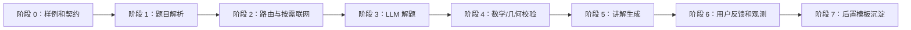

# 图片解析、按需联网与 LLM 讲解后端实施计划

版本：v3.1  
日期：2026-09-29  
目标：先验证“上传题目后快速获得可信、生动讲解”的核心闭环

## 1. 实施原则

1. 先完成单题闭环，再建设知识沉淀。
2. 先使用可替换 Adapter，不把供应商 SDK 写入业务层。
3. 先根据题目和用户要求路由，再选择直接 LLM 解题或检索后解题。
4. 每个阶段都必须有可运行验证样例。
5. 题库模板相关代码不进入当前用户主链路。

## 2. 阶段总览



## 3. 阶段 0：样例集和统一契约

### 目标

固定后续模块共同使用的输入输出，避免不同模型各自发明字段。

### 实现

- 定义 `QuestionAnalysis` JSON Schema；
- 定义 `ResearchContext` JSON Schema；
- 定义 `SolutionDraft` 和 `VerifiedSolution`，并固定 validation status 枚举；
- 定义 `LessonPlan` 输入约束；
- 统一模型、Prompt、搜索和校验的溯源记录；
- 定义 `lessonRevision`、`questionVersion` 和 `jobId` 的并发更新规则；
- 准备至少 30 道样例：
  - 普通计算题；
  - 分数应用题；
  - 方程题；
  - 普通几何题；
  - 多问几何题；
  - 模糊图片；
  - OCR 条件矛盾题；
  - 超出能力范围题。

### 验证

- Schema 可以校验所有样例；
- 每道样例有预期题型、关键条件和标准结果；
- 失败样例有明确的用户确认或 unsupported 路径；
- 生成结果具备完整的版本和调用溯源。

## 4. 阶段 1：多模态题目解析

### 目标

将图片转换为结构化题目，而不是只保存 OCR 文本。

### 模块

```text
QuestionAnalyzer
ImageQualityChecker
QuestionAnalysisRepository
```

### 实现

- 图片清晰度、尺寸、方向检测；
- 多模态模型 Adapter；
- 普通题目的数字、单位和公式抽取；
- 几何题的点、线、图形和关系抽取；
- 字段级置信度；
- 不确定项列表；
- 用户确认后生成新的题目版本。

### 验证

- 几何图形拓扑抽取测试；
- 数字和单位识别测试；
- 低置信度暂停测试；
- 用户修正不会重新调用 OCR 的测试。

## 5. 阶段 2：路由与按需联网

### 目标

在解题前决定是否需要外部参考，并明确搜索失败时的安全回退策略。

### 实现

- `ResearchRouter` 根据题目置信度、题型支持范围、复杂度和用户要求决定路径；
- 搜索 Adapter、来源筛选和 `ResearchContext` 持久化；
- 搜索内容按不可信输入处理，限制来源、超时、大小和重定向；
- 普通低风险题的搜索故障可以回退到直接解题，并标记 `research_unavailable`；
- 用户明确要求资料或题目依赖外部参考时，搜索失败必须暂停。

### 验证

- 普通题不触发搜索；
- 复杂几何题可以触发搜索；
- 搜索故障不会伪装成“已参考资料”；
- 搜索结果和模型推理在讲解中可区分。

## 6. 阶段 3：LLM 解题草稿

### 目标

让 LLM 基于结构化题目生成可校验的解题草稿。

### 输出要求

```json
{
  "method": "coordinate_geometry",
  "assumptions": [],
  "variables": {},
  "steps": [],
  "expressions": [],
  "finalAnswer": "",
  "uncertainties": []
}
```

### 实现

- 固定 Prompt 和 JSON Schema；
- 根据年级选择讲解和推理约束；
- 普通题与几何题使用不同 Solver；
- 记录模型、Prompt 版本和原始响应；
- 外部调用设置超时、重试和幂等键。

### 验证

- 相同输入输出可以被 Schema 解析；
- 模型无法确定时返回 uncertainty；
- 不允许直接输出未校验 LessonPlan。

## 7. 阶段 4：确定性校验

### 目标

阻止看似合理但错误的答案进入讲解。

### 普通数学题

- 表达式计算；
- 单位一致性；
- 结果代回；
- 分数、根式和小数规范化。

### 第一轮几何题范围

只实现已给坐标、可直接建立坐标系的基础矩形/三角形，以及长度、平行、垂直等可转化为数值约束的题目。一般纯证明题、圆、复杂相似/全等和需要自由构造辅助线的题目返回 `unsupported` 或 `needs_confirmation`。

### 几何题校验

- 坐标法计算；
- 向量和斜率检查；
- 平行、垂直和长度关系检查；
- 图形非退化检查；
- 子目标依赖检查。

### 验证

- 正确题目通过；
- 错误结果被拒绝；
- 条件不足时返回 `needs_confirmation`；
- 不在支持范围内时返回 `unsupported`；
- 校验结果包含可解释证据。

进入 `planning` 前，Worker 必须强制检查 `VerifiedSolution.validation.status == verified`。

## 8. 阶段 5：讲解生成与渲染

### 目标

将已验证的解法转化为适合当前年级的课程内容。

### 实现

- 结构化步骤；
- 公式逐步展开；
- 几何图形高亮；
- 易错点；
- voiceText；
- 相似练习题；
- 讲解内容版本化。

首轮只使用已定义的 LessonPlan Schema 和视觉类型。几何高亮、辅助线和关系标注必须先完成 Schema 扩展。

### 业务不变量

- 只有 `VerifiedSolution.validation.status = verified` 才能生成 ready Lesson；
- 讲解文字不能改变最终验证结果；
- 练习题答案必须单独校验；
- TTS 失败不能阻塞图文讲解。
- Solver 返回 `verified` 之外的状态不能生成 ready Lesson。
- 练习题及其答案必须单独通过校验。

## 9. 并发、幂等和任务恢复

- 每个 Job 携带 `jobId`、`lessonId`、`lessonRevision`、`questionVersion` 和 `attempt`；
- Lesson 更新使用 revision 条件更新，旧 Worker 更新失败时返回 `stale_job`；
- 用户确认后产生新题目版本，旧版本任务不得继续写入；
- 队列重复投递必须幂等，Worker 重启后从最后一个持久化阶段恢复；
- 创建幂等键只能解决重复创建，不能替代 Worker 的并发控制。

## 10. 阶段 6：反馈和观测

### 记录

- 每个阶段耗时；
- 模型调用次数和成本；
- 是否触发联网；
- 搜索来源；
- 校验失败原因；
- 用户是否修改题目；
- 用户是否请求换一种讲法；
- 用户反馈和练习结果。

### 核心指标

- 图片解析成功率；
- 字段修正率；
- 首次解题校验通过率；
- 联网触发率；
- 从上传到 ready 的延迟；
- 讲解重新生成率；
- 用户练习首次答对率。

同时记录模型、Prompt、搜索来源、校验证据和每个阶段的 `runId`，保证结果可以重放和审计。

## 11. 阶段 7：后置模板沉淀

只有前面链路积累真实数据后再做：

- 从已验证解法提取结构特征；
- 聚合同类数学题和几何题；
- 生成模板候选；
- 统计复用效果；
- 人工审核；
- 发布模板版本；
- 对高频题型增加缓存和快速路径。

模板沉淀不能阻塞单题讲解，也不能直接自动发布。

## 12. 推荐首轮实现范围

第一轮只实现：

1. `QuestionAnalysis` 契约；
2. 多模态解析 Adapter；
3. `ResearchRouter` 和搜索 Adapter；
4. LLM Solver Adapter；
5. 普通算术校验器；
6. 支持范围明确的基础几何坐标校验器；
7. `LessonPlan` 生成；
8. revision/version 并发控制、轮询进度和失败重试；
9. 30 道分层样例回归测试。

第一轮暂不实现：

- 自动模板沉淀；
- 向量数据库；
- 完整运营后台；
- 多模型自动路由优化；
- 微服务拆分。

## 13. 完成标准

当以下条件满足，才进入下一阶段：

- 普通题端到端成功率达到预先设定的 MVP 门槛；
- 支持范围内的几何题能够正确提取主要图形关系；
- 不支持的几何题返回 `unsupported`，不静默生成答案；
- 已知错误答案进入 `ready` 的比例为 0；
- 低置信度题目会请求用户确认；
- 外部模型超时可以重试，搜索故障不会伪造外部参考；
- Worker 重启不会丢失任务，重复投递不会重复执行最终写入；
- 用户确认后旧任务不能覆盖新题目版本；
- 每个结果都能追溯到题目版本、模型版本、Prompt、搜索来源和校验结果。

首轮样例集至少分为：普通计算题 8 道、分数/方程 6 道、应用题 5 道、基础几何 5 道、超出几何能力范围 3 道、模糊或矛盾图片 3 道。具体成功率、延迟和重试率门槛在开始编码前登记，不能使用“稳定”作为唯一验收标准。

## 14. 数据安全边界

- 原图、OCR 原始响应和外部检索内容必须定义保留期限；
- 发往第三方模型或搜索服务的内容不得包含不必要的学生身份信息；
- 不向外部搜索服务发送原图 URL，除非明确获得授权并使用短期签名地址；
- 外部网页内容必须与系统指令隔离；
- 记录外部服务失败、限流、超时和数据未发送状态。
