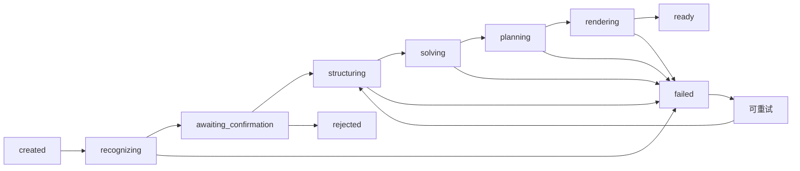

# 后端后续计划 v2

版本：v2.0  
日期：2026-09-02  
范围：后端与基础设施，不包含前端开发

分阶段实施与 Review 计划见：[BACKEND-IMPLEMENTATION-PLAN-v1.md](./BACKEND-IMPLEMENTATION-PLAN-v1.md)

## 1. 计划目标

围绕“讲给我听”的核心用户价值，完成一条可恢复、可验证、可追踪的单题闭环：

> 上传图片 → 识别题目 → 用户确认 → 结构化 → 数学求解与校验 → 生成适龄讲解 → 相似题练习 → 保存反馈

本版本不以“模块数量完成”为目标，而以以下结果为验收标准：

- 题目识别不确定时不会静默猜测；
- 未通过数学校验的结果不会进入讲解；
- Worker 重启或任务重复消费不会破坏 Lesson 状态；
- 用户可以知道系统当前处于哪个阶段，以及失败后如何处理；
- 练习结果可持久化，并能够支持后续产品质量指标。

## 2. 已确认的技术与产品决策

### 2.1 数据库

后端持久化统一使用 **MySQL**，不使用 PostgreSQL。

约束如下：

- 使用 InnoDB；
- 使用迁移脚本管理表结构；
- 使用 `JSON` 保存题目结构、求解证据和完整 LessonPlan；
- 使用 `VARCHAR` 保存状态；
- 使用 `DATETIME(3)` 保存时间；
- 使用事务保证 Lesson、状态事件和关键结果的一致性；
- 应用层负责状态转换，数据库层增加必要的唯一性和完整性约束。

架构文档和 README 中的数据库选型描述需要与本决策保持一致。

### 2.2 任务处理

开始接入真实 OCR/LLM 前，必须先具备 Redis 队列和可恢复 Worker。真实外部模型调用不再依赖内存 Channel。

第一版使用轮询获取进度，暂不优先实现 SSE。

### 2.3 模型职责

LLM 可以参与题目结构化、解法候选和教学规划，但不能直接作为最终计算器或答案来源。所有进入讲解的结果必须经过确定性规则或计算器校验。

### 2.4 LessonPlan 存储

MVP 以完整 LessonPlan JSON 作为主要存储单元，避免同时维护 JSON 和步骤表造成双重事实来源。

`lesson_steps` 暂不作为必需表；只有在未来需要单步编辑、局部重生成或独立分析时再引入。

### 2.5 朗读能力

PRD 将朗读列为 MVP 能力：

- MVP：LessonPlan 必须生成稳定的 `voiceText`，并保留 TTS Adapter 接口，可使用 Demo 音频完成端到端验证；
- P1：接入真实普通话 TTS、音频缓存和失败重试；
- TTS 失败不能阻塞图文讲解进入 `ready`。

## 3. 领域模型与状态机先行

这是所有持久化、Worker 和 API 工作的前置条件。

### 3.1 统一处理阶段

建议将当前较宽泛的 `planning` 拆为可观察的业务阶段：



说明：

- `awaiting_confirmation` 是用户可操作状态；
- `failed` 必须记录阶段、错误分类、重试次数和最后错误时间；
- 失败任务只有在错误类型可恢复时才允许重试；
- 用户修改确认内容后，重新从 `structuring` 开始，而不是重复 OCR；
- `rejected` 默认是终态，但应保留用户重新发起新 Lesson 的路径；
- 每次状态变化都写入 `lesson_status_events`，并通过事务与当前 Lesson 状态更新保持一致。

### 3.2 题目版本

题目需要保留版本关系：

- OCR 原始识别结果；
- 用户确认或修改后的文本；
- 对应版本的结构化题目；
- 对应版本的求解与讲解结果。

用户编辑题目时不能覆盖唯一历史值，否则无法回放错误、解释结果来源，也无法分析用户修改率。

### 3.3 答案标准化

练习答案不能采用简单字符串完全相等。需要支持：

- 空格和常见格式清理；
- 数字、中文数字和小数的统一；
- 分数的等值判断；
- 数值与单位分离；
- 单位要求和单位遗漏的区分；
- 无法安全解析时返回“请重新输入”，而不是误判。

## 4. 里程碑计划

### Milestone 0：领域契约与状态机

目标：固定后续所有模块共同遵守的业务事实。

交付内容：

- Lesson、QuestionDraft、StructuredQuestion、VerifiedSolution、LessonPlan、PracticeResult 的字段定义；
- 状态、状态转换和错误分类；
- 题目版本规则；
- LessonPlan JSON Schema；
- 视觉组件参数约束；
- API 状态和错误响应草案；
- 典型小学五、六年级题目样本集。

验收：

- 每个状态都有进入条件、离开条件和用户可见文案；
- 每个失败节点都有可恢复性定义；
- 同一份结构化题目能够被求解器、教学规划器和渲染器共同消费。

### Milestone 1：可靠任务基础（P0-A）

目标：让任务在真实环境中可持久化、可恢复、可追踪。

交付内容：

- MySQL 迁移和 Repository；
- `lessons`、题目版本、LessonPlan、练习结果、状态事件等核心表；
- S3 兼容对象存储；
- 原图元数据、文件类型和大小校验；
- Redis 队列；
- Worker 消费确认、幂等消费、超时、最大重试和指数退避；
- 统一的状态转换服务。

建议核心表：

```text
lessons
question_versions
lesson_plans
practice_results
lesson_status_events
job_attempts
```

MVP 先不建立 `lesson_steps`，完整讲解步骤保存在 `lesson_plans.plan_json` 中。

验收：

- API、Worker 重启后任务可继续处理；
- 同一任务重复消费不会重复生成或覆盖新版本；
- Lesson 当前状态与状态事件记录一致；
- 原图只存对象存储，数据库只保存 object key 和元数据。

### Milestone 2：真实内容闭环（P0-B）

目标：完成第一条真实图片到讲解结果的后端闭环。

交付内容：

- 真实 OCR Adapter；
- OCR 原始响应和字段级置信度保存；
- 低置信度暂停并返回用户确认；
- 用户确认接口和题目版本创建；
- 统一题目结构化模块；
- 年级、题型、知识点、已知条件、关系和问题目标；
- 结构完整性检查。

验收：

- 关键字段置信度不足时进入确认状态；
- 用户修改后只重新结构化，不重复调用 OCR；
- 结构不完整时有明确失败原因和下一步操作；
- 典型题目样本能够稳定输出结构化结果。

### Milestone 3：可验证解题与教学规划（P0-B）

目标：保证“讲得通”建立在“算得对”之上。

交付内容：

- 结构化算式计算；
- 单位检查；
- 结果代回条件；
- 多解法一致性检查；
- 五、六年级知识范围约束；
- 校验失败时停止生成讲解；
- LessonPlan 生成与 JSON Schema 校验；
- 最多 3 步讲解；
- `ratio_bar`、`groups`、`number_line`、`formula_reveal` 参数校验；
- 自动生成一道相似题；
- `voiceText` 生成。

验收：

- 未通过校验的题目不会进入 `ready`；
- 解释、公式、视觉参数和最终答案一致；
- 讲解符合年级和“长辈照着讲”的语言要求；
- 相似题具备可验证的标准答案。

### Milestone 4：API 与可观测性（P1）

目标：让前端能够可靠地呈现任务进度和异常恢复路径。

交付内容：

- 上传内容校验和请求体限制；
- 请求 ID、Lesson ID 和任务阶段；
- 统一错误码与错误响应；
- 幂等键；
- `learnerProfile`；
- 题目确认、拒绝和重试接口；
- 轮询接口返回阶段进度、用户操作建议和错误信息；
- 请求取消和超时处理；
- 阶段耗时、失败率、重试次数和模型调用成本指标。

### Milestone 5：真实模型与语音质量（P1）

目标：提升识别、讲解和朗读质量，同时控制外部模型风险。

交付内容：

- Prompt 模板隔离；
- LLM 模型选择和 JSON Schema 校验；
- 超时、重试和降级；
- OCR/LLM 原始响应保存与脱敏；
- Token、费用和延迟统计；
- 真实 TTS、音频缓存和失败重试；
- TTS 失败降级为图文讲解。

模型输出不得绕过结构化求解和最终校验。

### Milestone 6：安全、质量与运营能力（P2）

交付内容：

- MIME 类型与真实文件内容双重校验；
- 图片尺寸、压缩炸弹和异常文件防护；
- 文件名清洗与路径穿越防护；
- 请求限流；
- 日志脱敏；
- 图片/OCR 文本中的提示词注入隔离；
- 超纲、信息不完整和无法验证题目的明确拦截；
- MySQL、Redis、对象存储和端到端集成测试；
- 典型题目回归测试集。

## 5. API 闭环草案

```text
POST /api/lessons
  上传图片 + learnerProfile + 幂等键
  -> lessonId, status, progress

GET /api/lessons/:id
  -> status, stage, progress, questionVersion,
     lessonPlan, error, nextAction

POST /api/lessons/:id/question/confirm
  修改后的题目文本
  -> 新题目版本 + status: structuring

POST /api/lessons/:id/question/reject
  -> status: rejected

POST /api/lessons/:id/retry
  -> 仅对可恢复失败重新入队

POST /api/lessons/:id/practice
  用户答案
  -> correct, normalizedAnswer, feedback, expectedAnswer
```

其中 `nextAction` 是产品闭环的重要字段，例如：

```text
awaiting_confirmation -> confirm_question
failed                 -> retry_or_upload_again
ready                  -> start_practice
```

## 6. 测试与验收矩阵

| 层级 | 必测内容 |
|---|---|
| 领域 | 状态转换、版本关系、答案标准化、年级约束 |
| Repository | 事务、幂等更新、并发更新、状态事件一致性 |
| Worker | 重启恢复、重复消费、超时、退避、失败分类 |
| 文件 | MIME、大小、尺寸、缩略图、对象 key |
| 模型 | OCR 低置信度、结构不完整、JSON 不合法、提示词注入 |
| 求解 | 单位错误、代回失败、多解法不一致、超纲题 |
| 教学 | 3 步限制、公式一致性、视觉参数合法性、voiceText |
| API | 幂等、请求取消、错误码、进度和下一步操作 |
| 端到端 | 图片上传到 ready，再到练习结果记录 |

## 7. 首个实施切片

第一轮只实现以下最小切片，不扩展到账号、历史记录、批改整页作业或复杂视频：

1. MySQL 迁移、Lesson Repository 和状态事件；
2. S3 图片保存与读取；
3. Redis 队列和可恢复 Worker；
4. 真实 OCR 与低置信度确认；
5. 一种典型分数应用题的结构化、求解和校验；
6. 固定 3 步 LessonPlan 与相似题；
7. 练习答案标准化和结果持久化；
8. 上传到 ready 的端到端回归测试。

首轮完成后再扩大题型覆盖范围，而不是先追求“支持所有小学数学题”。

## 8. 暂不做

- 用户登录、家庭成员和多账号；
- 历史题目管理；
- 教师审核和社交分享；
- 整页作业自动批改；
- 复杂动画和视频生成；
- 多来源搜索聚合；
- 微服务拆分；
- 在没有质量数据前接入复杂 Agent 编排框架。

## 9. 关键产品指标

- OCR 关键字段准确率和用户修改率；
- 低置信度拦截率；
- 解题校验失败率与错误答案拦截率；
- 上传到确认、确认到 ready 的分阶段耗时；
- 长辈依据讲解复述步骤的成功率；
- 相似题首次答对率；
- “换一种讲法”请求率；
- Worker 重试成功率和重复消费率；
- 单题 OCR、LLM、TTS 成本。

## 10. 计划完成定义

只有同时满足以下条件，才认为后端第一版闭环完成：

- 真实图片能够被持久化并进入可恢复任务队列；
- 识别不确定时用户能够修改题目并继续处理；
- 解题结果有可追溯的校验证据；
- 讲解内容、算式、视觉和最终答案一致；
- 练习提交能够标准化判定并保存；
- 失败、重试和任务进度对用户及运营人员可解释；
- 端到端回归样本持续通过。
