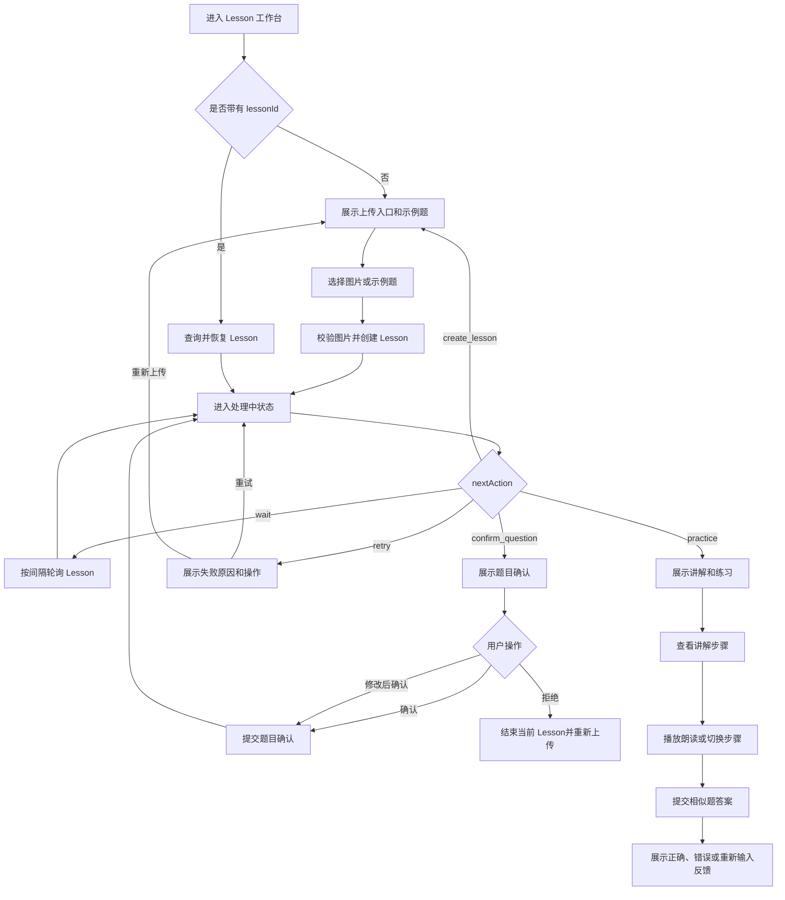
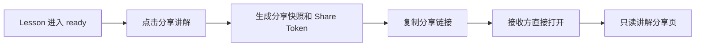

# Guide Flow 前端产品需求文档

版本：v1.0  
日期：2026-09-23  
状态：待评审  
适用范围：Vue3 Web 前端 MVP  
关联文档：[BACKEND-IMPLEMENTATION-PLAN-v1.md](./BACKEND-IMPLEMENTATION-PLAN-v1.md)、[PRD-v1.md](./PRD-v1.md)、[ARCHITECTURE-v1.md](./ARCHITECTURE-v1.md)

## 1. 文档目标

本文档定义 Guide Flow 第一版 Web 前端的产品范围、用户流程、页面状态、核心交互和验收标准。

本版本只解决一个核心问题：

> 长辈上传一道小学数学题后，能够确认系统是否读对题目，并用孩子听得懂的方式完成一次分步讲解和相似题练习。

本文档不定义 Vue 组件实现细节，也不替代后端领域模型和 API 设计。前端只消费后端返回的 Lesson 状态与 LessonPlan，不自行推导题目答案或讲解逻辑。

## 2. 产品定位

### 2.1 产品定位

Guide Flow 是一个面向小学五、六年级家庭辅导场景的“讲解工作台”。它不是单纯的拍题答案工具，而是帮助家长和长辈完成：

```text
看懂题目 → 讲清思路 → 带孩子练习
```

### 2.2 核心用户价值

| 用户痛点 | 前端提供的价值 |
|---|---|
| 不确定照片中的题目有没有被正确识别 | 明确展示识别结果和需要检查的内容 |
| 会算但不知道如何向孩子解释 | 将讲解拆成最多 3 步，并提供口语化朗读文本 |
| 担心 AI 算错或讲错 | 展示处理阶段和可信的结果边界，不静默猜测 |
| 讲完后不知道孩子是否真正理解 | 提供一道同知识点的相似题进行练习 |
| 处理失败后不知道怎么办 | 用用户语言说明原因，并给出重试或重新上传入口 |

### 2.3 产品记忆点

前端视觉和交互采用“家庭讲解桌 / 作业讲义”的概念：

- 题目像被放在桌面上的作业纸；
- 每一步讲解像一张可翻阅的讲义卡；
- 重点数字、公式和视觉关系使用少量醒目色强调；
- 页面给人的感受应是耐心、清楚、可信，而不是复杂的 AI 控制台。

## 3. 目标用户与使用场景

### 3.1 目标用户

MVP 目标用户为辅导小学五、六年级孩子作业的家长和长辈，尤其是：

- 能使用手机或电脑浏览器上传图片；
- 需要快速理解一道具体题目；
- 更关心“怎么讲”而不只是“答案是多少”；
- 不希望学习复杂的 AI 产品操作。

### 3.2 核心场景

#### 场景 A：长辈辅导作业

奶奶看到孩子作业中的分数应用题，自己不确定解题步骤。她上传题目，确认文字无误后，按步骤听讲解，再照着讲给孩子听。

#### 场景 B：家长快速备课

家长在辅导前先上传一道题，快速查看题意、关键关系和相似题，用于准备解释方式。

#### 场景 C：识别结果不确定

题目照片中的数字或分数模糊，系统无法确认。用户检查并修改题目文字后继续，不需要重新上传或重新识别。

### 3.3 非目标用户

本版本不重点服务：

- 教师批量管理整班作业；
- 需要整页作业批量识别的用户；
- 需要复杂几何作图或高年级竞赛题解答的用户；
- 需要账户、家庭成员和历史题库管理的长期用户。

## 4. 产品目标与成功标准

### 4.1 MVP 产品目标

用户能够在一个 Web 工作台内完成以下闭环：

```text
上传图片
  → 查看识别结果
  → 必要时修改并确认题目
  → 查看 3 步以内讲解
  → 听取讲解
  → 完成相似题
  → 获得答题反馈
```

### 4.2 体验目标

| 目标 | 验收方向 |
|---|---|
| 易理解 | 首屏 5 秒内能理解“上传题目并获得讲解” |
| 可控 | 用户知道系统当前阶段和下一步动作 |
| 可信 | 低置信度内容必须显式请求确认 |
| 可讲 | 长辈能根据步骤标题、解释和朗读文本复述解法 |
| 可完成 | 移动端和桌面端都能完成一次核心闭环 |
| 可恢复 | 任务失败后无需刷新页面即可重试或重新上传 |

### 4.3 建议观测指标

第一版不强制建设完整埋点平台，但页面结构应为以下指标预留事件：

| 指标 | 说明 |
|---|---|
| 上传开始率 | 用户进入工作台后尝试上传的比例 |
| 上传成功率 | 文件校验和创建 Lesson 成功的比例 |
| 题目修改率 | 识别后修改题目文本的比例 |
| 题目确认完成率 | 进入确认状态后继续生成的比例 |
| 讲解完成率 | 到达 ready 后查看完所有步骤的比例 |
| 朗读使用率 | 点击“听我讲”的比例 |
| 相似题提交率 | 到达练习阶段后提交答案的比例 |
| 相似题首次答对率 | 第一次提交即答对的比例 |
| 分享生成率 | 进入 ready 后生成分享链接的比例 |
| 分享打开率 | 分享链接被接收方成功打开的比例 |
| 失败重试率 | 失败后重试与重新上传的比例 |

## 5. MVP 范围

### 5.1 必须实现（P0）

- Web 工作台首页；
- JPG、PNG 题目图片上传；
- 文件格式、大小和基础图片错误提示；
- 图片本地预览；
- 示例题入口；
- Lesson 创建后的异步处理状态展示；
- 识别结果展示；
- 题目文本编辑和确认；
- 低置信度内容提醒；
- 结构化、求解、规划、渲染阶段的用户化状态文案；
- LessonPlan 三步以内讲解展示；
- `ratio_bar`、`groups`、`number_line`、`formula_reveal` 四类视觉组件的基础渲染；
- 步骤前后切换；
- `voiceText` 朗读入口；
- 相似题展示；
- 答案提交和结果反馈；
- 生成只读讲解分享链接；
- 分享链接可直接打开讲解分享页；
- 失败、重试和重新上传；
- 页面刷新后根据 Lesson ID 恢复任务；
- 移动端基础适配。

### 5.2 暂不实现

- 登录、注册和多用户体系；
- Lesson 历史列表；
- 家长和孩子双角色；
- 整页作业批量识别；
- 在线支付；
- 下载 PDF 讲解单；
- 复杂动画视频生成；
- 用户自定义讲解风格；
- 多道题连续队列；
- SSE 或 WebSocket 实时推送；
- 前端直接调用 OCR、LLM 或 TTS 供应商。

## 6. 信息架构

MVP 采用单工作台结构，不按后端处理阶段拆分独立页面。

```text
Guide Flow
└── Lesson 工作台
    ├── 新建题目
    │   ├── 上传照片
    │   └── 选择示例题
    ├── 处理状态
    │   ├── 识别中
    │   ├── 待确认
    │   ├── 整理中
    │   └── 失败
    ├── 讲解结果
    │   ├── 题目摘要
    │   ├── 分步讲解
    │   ├── 视觉演示
    │   └── 朗读
    ├── 练习巩固
        ├── 相似题
        └── 答案反馈
    └── 讲解分享
        ├── 生成分享链接
        └── 只读分享页
```

推荐 URL 结构：

```text
/                         新建 Lesson 工作台
/lessons/:lessonId        恢复或查看一个 Lesson
/share/:shareToken        对外只读讲解分享页
```

MVP 不要求独立的首页、历史页或设置页。分享页是面向接收方的独立只读页面，不复用用户工作台的编辑和任务控制界面。

## 7. 核心用户流程



## 8. 页面与状态设计

### 8.1 工作台整体布局

桌面端采用“入口区 + 讲解区”的双栏布局：

```text
┌────────────────────────────────────────────────────────┐
│ 品牌 / 当前 Lesson 状态 / 新建题目                      │
├────────────────────────────────────────────────────────┤
│                                                        │
│  入口与任务信息       当前主要内容                      │
│  ┌──────────────┐     ┌────────────────────────────┐   │
│  │ 上传题目      │     │ 识别确认 / 处理中 / 讲解     │   │
│  │ 示例题        │     │                            │   │
│  │ 隐私提示      │     │                            │   │
│  └──────────────┘     └────────────────────────────┘   │
│                                                        │
└────────────────────────────────────────────────────────┘
```

移动端按以下顺序纵向排列：

```text
Header
阶段提示
当前主要任务
辅助信息
下一步操作
```

### 8.2 空白状态

#### 目标

让第一次进入的用户立即知道产品能做什么，并在一个操作内开始使用。

#### 推荐内容

主标题：

> 拍一道题，我帮你整理成孩子听得懂的讲法。

辅助说明：

> 先看懂题目，再一步一步讲清楚，不只给你一个答案。

主要操作：

- `上传题目照片`：主按钮；
- `先试试示例题`：次按钮。

辅助提示：

- 支持 JPG、PNG；
- 尽量拍清楚题干、数字和图形；
- 图片仅用于本次讲解。

#### 验收标准

- 用户不阅读说明也能理解主按钮用途；
- 上传区域支持点击；
- 示例题不依赖图片上传或后端服务即可进入讲解体验；
- 空白状态不会展示过多技术信息。

### 8.3 上传状态

上传分为三个用户可感知阶段：

```text
选择文件 → 本地检查 → 创建 Lesson
```

选择文件后立即展示：

- 文件缩略图；
- 文件名；
- 文件大小；
- 校验状态。

校验失败时需要指出原因，例如：

- 图片格式不支持；
- 图片太大；
- 图片无法读取；
- 没有选择文件。

上传过程中：

- 禁止重复点击创建；
- 主按钮显示“正在上传”；
- 保留图片预览；
- 网络失败时保留重新上传入口。

### 8.4 处理中状态

处理中页面不使用空白 loading 作为主要反馈，而是展示阶段列表：

```text
正在准备这道题

✓ 图片已收到
✓ 正在读题目
○ 正在检查数字和单位
○ 正在整理讲解步骤
```

后端内部状态到用户语言的映射如下：

| 后端状态 / 阶段 | 用户标题 | 辅助说明 | 用户动作 |
|---|---|---|---|
| `created` | 正在准备题目 | 图片已经收到 | 等待 |
| `recognizing` | 正在读题目 | 正在检查题目文字、数字和单位 | 等待 |
| `awaiting_confirmation` | 请帮我确认一下 | 有些内容需要你看一眼 | 确认或修改 |
| `structuring` | 正在整理题目 | 正在找出已知条件和问题目标 | 等待 |
| `solving` | 正在检查算式 | 正在验证计算过程和答案 | 等待 |
| `planning` | 正在准备讲法 | 正在把解法改成孩子听得懂的话 | 等待 |
| `rendering` | 正在画出步骤 | 正在准备比例条、分组或数轴 | 等待 |
| `ready` | 可以开始讲了 | 讲解已经准备好 | 查看讲解 |
| `failed` | 这道题暂时没整理好 | 根据错误类型给出下一步 | 重试或重新上传 |
| `rejected` | 这道题没有继续处理 | 可以重新上传另一道题 | 新建 Lesson |

`progress` 只作为阶段视觉辅助，不向用户承诺精确剩余时间。优先展示阶段文案，而不是突出百分比。

### 8.5 题目确认状态

#### 触发条件

后端返回 `nextAction = confirm_question`，通常代表关键数字、分数、单位、公式、问题目标或图形描述存在不确定性。

#### 页面结构

```text
┌──────────────────────────────────────┐
│ 我看到了这道题，请帮我确认一下          │
│                                      │
│ [题目图片缩略图]                      │
│                                      │
│ 题目文字                              │
│ ┌──────────────────────────────────┐ │
│ │ 可编辑的题目文本                   │ │
│ └──────────────────────────────────┘ │
│                                      │
│ 建议重点检查：数字、分数、单位和问题     │
│                                      │
│ [重新上传]       [确认，继续讲解]       │
└──────────────────────────────────────┘
```

#### 交互规则

- 文本框默认填充 OCR 结果；
- 用户可以直接修改文字；
- 用户未修改时也可以直接确认；
- 文本为空时不能提交；
- 超过后端限制时展示字符数提示；
- 提交期间按钮进入 loading，禁止重复提交；
- 确认后进入 `structuring`，不重新调用 OCR；
- 拒绝后进入 `rejected`，页面提供“重新上传”操作；
- 页面刷新后仍保留当前确认状态。

#### 信任设计

主文案不使用“低置信度”作为用户第一视觉，而使用：

> 有些内容我看得不太确定，请你帮我看一眼。

如果后端提供字段级不确定信息，前端可对数字或分数增加轻量标记；如果暂时没有字段级信息，则展示统一检查提示。

### 8.6 讲解结果状态

#### 页面结构

```text
题目摘要
  ├── 题目文本
  ├── 题型标签
  ├── 年级 / 知识点标签
  └── 识别或确认状态

讲解步骤
  ├── 当前步骤编号
  ├── 步骤标题
  ├── 口语化解释
  ├── 公式或算式
  ├── 视觉演示
  ├── 听我讲
  └── 上一步 / 下一步

巩固练习
  ├── 相似题
  ├── 答案输入
  └── 反馈
```

#### 讲解规则

- 最多展示 3 个步骤；
- 默认打开第 1 步；
- 步骤标题优先使用用户能复述的语言；
- 解释先说明“为什么”，再展示算式；
- 公式、视觉和文字必须来自同一个 LessonPlan；
- 最终答案在用户浏览完步骤后展示，不在页面首屏抢占注意力；
- 允许反复查看上一步；
- 朗读按钮使用当前步骤的 `voiceText`；
- 朗读失败不影响图文讲解。

#### 步骤切换

- 点击“下一步”进入下一张讲义卡；
- 第一步禁用“上一步”；
- 最后一步将“下一步”改为“去做相似题”；
- 支持点击步骤圆点直接切换；
- 切换步骤时不重新请求后端；
- 移动端支持左右滑动，但必须保留明确的按钮操作。

### 8.7 视觉组件

前端只渲染后端允许的视觉类型，不根据自然语言猜测图形。

| 类型 | 适用场景 | 前端表现 |
|---|---|---|
| `ratio_bar` | 分数、比例、部分与整体 | 分段比例条 |
| `groups` | 平均分组、每组数量 | 多组方块或圆点 |
| `number_line` | 数量变化、区间和位置 | 带标记的数轴 |
| `formula_reveal` | 算式拆解 | 按步骤突出算式片段 |

通用降级规则：

- `visual` 缺失时展示纯文字和公式；
- `visual.type` 不支持时展示“暂时无法绘制图示”，不能阻塞讲解；
- 参数不合法时不渲染空白区域，改为紧凑的文字说明；
- 视觉组件不得替代文字解释；
- 视觉组件不得自行计算比例或答案。

### 8.8 朗读

#### MVP 目标

帮助长辈直接听到适合讲给孩子的表达。

#### 交互

- 默认按钮文案为“听我讲”；
- 播放中显示“正在朗读”；
- 再次点击可暂停或停止；
- 切换步骤后停止上一段朗读；
- 朗读失败时保留文字内容，并提示“可以直接照着文字讲”；
- 不要求用户配置声音、语速或音色。

MVP 可以优先使用浏览器端朗读能力，后续再接入后端 TTS。无论实现方式如何，前端消费的内容都应来自 `voiceText`。

### 8.9 练习状态

#### 页面结构

```text
换一道相似的，你来试试

[相似题文本]

我的答案：[输入框] [单位] [检查一下]
```

#### 反馈规则

| 结果 | 用户反馈 | 是否展示标准答案 |
|---|---|---|
| 正确 | 太好了，你找对了这一步 | 可以展示简短解释 |
| 错误但可解析 | 再想一想“先算哪一部分” | 暂不立即展示完整答案 |
| 无法解析 | 我没看懂这个答案，请换一种写法 | 不判定对错 |
| 网络或服务失败 | 这次检查没有完成，请重试 | 不改变本地输入 |

用户可以多次提交。每次提交前保留输入内容，提交成功后清空输入或由后端结果决定，避免误丢失答案。

### 8.10 讲解分享与导出

#### 用户场景

一个用户在网站上完成题目解析后，希望把“已经整理好的讲解”发给家人、孩子或老师。接收方不需要重新上传题目，也不需要理解系统的处理状态，打开链接即可阅读。

#### 产品定义

本功能拆分为两个结果：

```text
分享讲解 = 生成可直接打开的只读 Web 页面（P0）
下载讲解 = 生成适合打印或保存的 PDF 讲解单（P1）
```

用户在 Lesson 进入 `ready` 后看到：

```text
[分享讲解]  [下载 PDF]
```

其中“分享讲解”是首要动作，“下载 PDF”作为辅助动作。

#### 分享流程



#### 分享页内容

分享页展示：

- 已确认的题目文字；
- 题型、年级和知识点；
- 最多 3 步讲解；
- 公式和视觉演示；
- 最终答案；
- 相似题练习；
- 当前步骤的朗读入口。

分享页不展示：

- 上传入口；
- 修改题目入口；
- 重试任务入口；
- OCR 置信度和内部处理阶段；
- 请求 ID、模型名称、Worker、Redis 等技术信息；
- 原始 OCR 长响应。

#### 分享页交互

- 接收方打开 `/share/:shareToken` 后直接进入内容页；
- MVP 不要求接收方登录；
- 分享页为只读，不允许修改原题或重新生成讲解；
- 接收方可以切换讲解步骤和播放朗读；
- 接收方可以填写相似题答案；
- 分享页上的练习结果只保存在当前浏览器，不写入原用户的 Lesson；
- 分享链接生成后提供“复制链接”反馈；
- 链接无效或失效时展示明确的重新获取提示。

#### 分享内容冻结规则

分享内容必须是生成时的 LessonPlan 快照，而不是每次打开时读取当前 Lesson 的最新结果。

```text
ShareSnapshot
├── shareToken
├── lessonId
├── questionVersion
├── lessonPlanVersion
├── createdAt
├── expiresAt（可选）
└── revokedAt（可选）
```

业务不变量：

- 用户后续修改题目或重新生成讲解，不改变已经分享出去的内容；
- 分享链接只能读取快照，不能触发任务重试或题目确认；
- 分享快照必须来自 `ready` 状态的完整 LessonPlan；
- 未生成完整 LessonPlan 时不允许创建分享链接；
- 默认不分享原始题目图片，以降低姓名、学校和作业本信息泄露风险。

#### PDF 讲解单

PDF 作为 P1 能力，内容包括：

```text
标题
题目文字
第 1 步：解释、算式、视觉
第 2 步：解释、算式、视觉
第 3 步：检查与最终答案
相似题
```

PDF 不需要包含内部状态、请求 ID、原始图片或模型响应。第一版可以优先使用浏览器打印能力，后续再考虑服务端生成固定版式 PDF。

## 9. 状态与前端动作规则

前端不根据多个字段自行推断下一步，主操作优先依据后端 `nextAction`。

| `nextAction` | 主操作 | 页面行为 |
|---|---|---|
| `wait` | 无 | 启动或继续轮询 |
| `confirm_question` | 确认，继续讲解 | 打开题目编辑和确认 |
| `retry` | 再试一次 | 仅在允许重试时调用 retry |
| `practice` | 去做相似题 | 展示完整讲解和练习 |
| `create_lesson` | 重新上传题目 | 清理当前 Lesson 状态 |

状态不变量：

- 只有一个 Lesson 处于当前工作台上下文；
- 同一动作提交期间不可重复触发；
- 轮询结束状态包括 `ready`、`failed`、`rejected`；
- 轮询失败不能覆盖最后一次成功的 Lesson 数据；
- 旧 Lesson 的响应不能覆盖用户已经创建的新 Lesson；
- 当前步骤索引是阅读状态，不参与后端状态转换。

## 10. 异常与错误体验

### 10.1 错误文案原则

错误提示必须包含：

```text
发生了什么 + 用户可以做什么
```

示例：

| 技术情况 | 用户文案 | 操作 |
|---|---|---|
| 图片格式错误 | 这张图片格式暂时不支持，请换一张 JPG 或 PNG | 重新选择 |
| 图片过大 | 图片有点大，请换一张更小的照片 | 重新选择 |
| OCR 无法识别 | 我没能看清这道题，请拍清楚题干和数字后重试 | 重新上传 |
| 服务暂时失败 | 这次讲解没有完成，可以再试一次 | 重试 |
| 题目暂不支持 | 这道题暂时超出当前讲解范围 | 重新上传 |
| 网络中断 | 网络好像断开了，恢复后可以继续查询 | 重试 |

### 10.2 不应展示的内容

- 数据库错误；
- Worker、Redis、MySQL 等内部组件名称；
- OCR 供应商名称；
- 原始模型响应；
- 内部请求 ID 作为主提示；
- 让用户自己判断错误码含义的技术信息。

### 10.3 重试规则

- 可重试失败展示“再试一次”；
- 业务不可恢复失败展示“重新上传”；
- 重试按钮提交期间禁用；
- 重试后回到对应失败前阶段，而不是总是回到上传页；
- 重试次数由后端控制，前端不自行限制业务次数；
- 连续失败时提供重新上传入口，避免用户陷入重复点击。

## 11. 响应式和可访问性要求

### 11.1 响应式断点

至少支持：

- 手机宽度：320px–767px；
- 平板宽度：768px–1199px；
- 桌面宽度：1200px 以上。

### 11.2 移动端要求

- 上传按钮和确认按钮保持足够点击面积；
- 题目文本不得横向溢出；
- 公式和视觉组件允许纵向换行；
- 讲解步骤不依赖 hover；
- 输入法弹出时练习按钮仍可操作；
- 重要错误信息不能只通过颜色表达。

### 11.3 可访问性要求

- 上传控件有明确 label；
- 状态变化使用 `aria-live` 或等效方式通知；
- 图片必须有替代文本；
- 按钮文案表达动作，不只使用图标；
- 颜色对比度满足基本阅读要求；
- 键盘可以完成上传后的确认、步骤切换和练习提交。

## 12. API 依赖与待确认项

前端依赖的 API：

```text
POST /api/lessons
GET  /api/lessons/:id
POST /api/lessons/:id/question/confirm
POST /api/lessons/:id/question/reject
POST /api/lessons/:id/retry
POST /api/lessons/:id/practice
POST /api/lessons/:id/shares
GET  /api/shares/:shareToken
```

开始前端实现前，需要确认：

1. `POST /api/lessons` 的 multipart 字段名、幂等键字段和 `learnerProfile` 格式；
2. 图片预览是否只使用浏览器本地对象 URL，还是需要后端返回临时访问 URL；
3. `QuestionDraft` 是否包含字段级置信度和不确定字段；
4. `LessonPlan.steps[].visual` 的完整参数结构；
5. 朗读 MVP 使用浏览器 Web Speech API，还是后端返回音频地址；
6. `failureKind` 与可重试动作的映射；
7. 练习提交失败、答案不可解析和答案错误的响应区别；
8. 未登录用户是否可以直接创建和恢复 Lesson；
9. 页面刷新后 Lesson 是否通过 URL 参数恢复；
10. 后端返回时间、百分比和状态枚举的稳定格式。
11. 创建分享是否只允许 `ready` 状态；
12. 分享 Token 的长度、有效期和撤销语义；
13. 分享快照是否由后端持久化，还是由前端生成临时链接；
14. PDF 第一版使用浏览器打印，还是由后端返回 PDF 文件；
15. 分享页练习结果是否明确保持匿名且不回写原 Lesson。

其中第 3、4、6、11、12、13 项会直接影响组件边界和状态设计，应在前端架构文档前确认。

## 13. Feature Backlog

| 优先级 | 功能 | 版本 | 备注 |
|---|---|---|---|
| P0 | 上传题目照片 | MVP | JPG/PNG |
| P0 | 示例题 | MVP | 用于体验完整闭环 |
| P0 | 上传预览和文件校验 | MVP | 格式、大小、可读性 |
| P0 | Lesson 轮询 | MVP | 第一版不做 SSE |
| P0 | 题目确认和修改 | MVP | 低置信度必须确认 |
| P0 | 处理阶段反馈 | MVP | 用户语言，不暴露内部实现 |
| P0 | 三步讲解 | MVP | 默认最多 3 步 |
| P0 | 四类基础视觉 | MVP | 严格按 Schema 渲染 |
| P0 | 朗读入口 | MVP | 优先消费 voiceText |
| P0 | 相似题练习 | MVP | 复用 LessonPlan.practice |
| P0 | 错误和重试 | MVP | 按 failureKind 决策 |
| P0 | 生成讲解分享链接 | MVP | 只允许 ready 状态 |
| P0 | 只读分享页 | MVP | 支持直接打开和匿名查看 |
| P1 | 下载 PDF 讲解单 | 后续 | 优先支持浏览器打印 |
| P1 | 字段级不确定标记 | 后续 | 依赖后端扩展 |
| P1 | 重新讲一遍 | 后续 | 需要新的产品动作和 API |
| P1 | 换一种讲法 | 后续 | 需要重新规划教学内容 |
| P1 | Lesson 历史记录 | 后续 | 依赖身份体系 |
| P2 | 家庭成员体系 | 后续 | 多角色和数据隔离 |
| P2 | 批量作业处理 | 后续 | 新的任务模型 |

## 14. MVP 验收标准

### 14.1 核心流程

- 用户可以从空白工作台上传一张 JPG 或 PNG；
- 用户可以选择示例题并跳过真实上传；
- 创建 Lesson 后页面展示当前处理阶段；
- 页面通过轮询获得最新 Lesson 状态；
- 低置信度 Lesson 会进入题目确认，而不是直接展示讲解；
- 用户可以修改题目文本并提交确认；
- 用户确认后不重复 OCR，并继续进入后续处理；
- Lesson 成功后展示不超过 3 个讲解步骤；
- 用户可以在步骤之间前后切换；
- 用户可以播放当前步骤的朗读文本；
- 用户可以提交相似题答案并看到反馈；
- Lesson 成功后可以生成一个只读讲解分享链接；
- 接收方无需登录即可直接打开分享链接；
- 分享页可以展示题目、讲解步骤、视觉、朗读和相似题；
- 分享页不允许修改原题、重试任务或覆盖原用户的 Lesson；
- 分享内容在原 Lesson 后续变化后仍保持创建时的版本；
- 任务失败时能看到重试或重新上传入口。

### 14.2 状态与数据安全

- 轮询不会产生重复提交；
- 用户重复点击确认不会创建重复题目版本；
- 新 Lesson 的响应不会覆盖旧 Lesson；
- 页面刷新后能根据 Lesson ID 恢复可恢复状态；
- 后端错误不会被前端包装成“讲解成功”；
- 不在前端保存或展示模型原始响应。
- 未完成的 Lesson 不能生成分享链接；
- 分享页的匿名练习结果不会写回原用户 Lesson；
- 不默认在分享页展示原始题目图片。

### 14.3 视觉与布局

- 桌面端采用入口区和讲解区双栏布局；
- 移动端主要内容纵向排列且不横向溢出；
- 上传、确认、重试、下一步等主要按钮清晰可见；
- 视觉组件缺失或不支持时仍能展示文字讲解；
- 页面保持温暖、清楚、可信的“家庭讲解桌”视觉方向。

## 15. 建议实施顺序

前端开发前先完成本 PRD Review，然后按以下顺序执行：

1. 固定 API 类型和 Lesson 状态映射；
2. 创建 Vue3 + TypeScript + Vite 工程骨架；
3. 完成静态空白、示例题、确认、讲解和练习状态；
4. 接入创建 Lesson 和查询 Lesson；
5. 接入题目确认、拒绝、失败重试；
6. 接入 LessonPlan 和视觉组件；
7. 接入练习提交和反馈；
8. 接入分享快照、分享链接和只读分享页；
9. 完成 PDF 打印方案；
10. 完成移动端、异常路径和端到端验收。

## 16. 本版本已知限制

- 当前后端 API 已能表达整体状态，但字段级不确定信息仍需确认是否对外返回；
- 当前 LessonPlan Schema 的视觉参数需要在前端实现前进一步固定；
- 尚未决定浏览器朗读和后端 TTS 的优先级；
- 没有登录体系，因此 Lesson 恢复能力依赖 URL 和当前浏览器上下文；
- 轮询会带来处理期间的请求开销，后续可根据真实使用量评估 SSE；
- MVP 只支持有限题型，前端必须清楚表达暂不支持的情况。
- 分享链接的撤销、过期和访问统计暂不纳入第一版；
- PDF 第一版是否由浏览器打印生成，仍需在前端架构阶段确认。

## 17. 待评审决策

本 PRD 评审时需要重点确认以下决策：

1. 是否接受单 Lesson 工作台作为 MVP 主入口；
2. 是否将题目确认作为所有关键字段不确定时的强制步骤；
3. MVP 朗读是否先使用浏览器能力；
4. 是否暂不建设历史记录和登录；
5. 是否将“最多 3 步讲解”作为前端硬性展示约束；
6. 是否沿用现有静态原型的“温暖讲义桌”视觉方向；
7. 是否接受“分享链接 P0、PDF P1”的优先级；
8. 是否接受分享页匿名只读、练习结果不回写原 Lesson；
9. 是否接受分享内容以 LessonPlan 冻结快照为事实来源。

本 PRD 评审通过后，再生成 [FRONTEND-ARCHITECTURE-v1.md](./FRONTEND-ARCHITECTURE-v1.md)，并开始创建 `/frontend` 前端基础工程。
