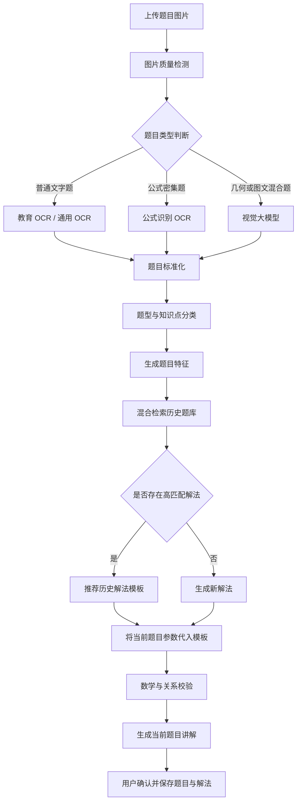
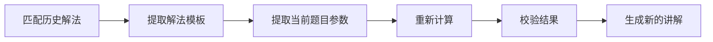

# OCR、视觉理解与题库路由方案 v1

## 1. 文档目的

本文记录 guide-flow 当前关于题目图片识别、历史题库复用和解法推荐的讨论结论，作为后续 PRD、接口设计和实现拆分的依据。

核心目标不是每次上传题目后都重新生成一套解答，而是识别出题目的题型与解题结构，优先推荐已有的高质量解法，再根据当前题目的具体数据生成新的讲解。

## 2. 产品判断

当前场景中需要区分四个问题：

1. **题目识别**：图片中写了什么。
2. **题目理解**：这道题属于什么题型，包含哪些已知条件和图形关系。
3. **解法匹配**：历史题库中是否存在相同解题思路。
4. **当前题目讲解**：如何将历史解法应用到当前题目的具体数据上。

OCR 主要解决第一个问题；视觉大模型和 LLM 主要参与第二、第三和第四个问题；题库检索负责寻找历史内容；数学或规则校验负责保证重新计算的正确性。

## 3. 推荐总体流程



## 4. OCR 与视觉大模型的职责边界

### 4.1 OCR 的职责

- 提取中文题干。
- 提取数字、字母和标点。
- 提取数学公式及 Latex 表达式。
- 返回文字、公式和题目区域的位置。
- 为题目建立可检索的标准化文本。

OCR 的优势是结果相对稳定、成本可预期、便于定位识别错误。它适合普通文字题、公式题和大批量题目入库。

### 4.2 视觉大模型的职责

- 理解图片中的题目整体含义。
- 判断题型和知识点。
- 理解几何图形中的点、线、交点和关系。
- 提取文字与图形之间的关联。
- 生成题目介绍、标签和解题特征。
- 对历史解法进行语义匹配。

视觉大模型不应直接作为唯一的数学正确性保证。对于几何题，模型可能误判点线关系；对于计算题，模型可能生成看似合理但错误的结果。因此需要保留结构化校验、数学计算和用户确认环节。

### 4.3 推荐分工

| 题目类型 | 推荐前置能力 | 后续处理 |
|---|---|---|
| 普通文字题 | 教育 OCR | 标准化、分类、题库检索 |
| 分数、方程、根式题 | 教育 OCR + 公式识别 | Latex 标准化、规则计算 |
| 试卷或多小题图片 | 试卷识别/切题 OCR | 拆分成多个 Question |
| 几何图形题 | OCR + 视觉大模型 | 图形关系抽取、几何校验 |
| 模糊或复杂排版 | 视觉大模型 | 输出不确定项并请求确认 |

## 5. 题库复用的核心机制

### 5.1 不能只按原始题干匹配

以下两道题的数字和描述不同，但可以使用同一个解法：

```text
一本书共 120 页，第一天看了 1/3，求剩余页数。

一本书共 180 页，第一天阅读了 2/5，求还剩多少页。
```

它们的共同结构是：

```text
剩余量 = 总量 - 总量 × 已完成比例
```

因此题库需要保存“题目结构”和“解法模板”，不能只保存原始文本或历史答案。

### 5.2 题目特征

每道题建议生成以下特征：

| 特征 | 示例 |
|---|---|
| 题型 | 分数应用题 |
| 知识点 | 分数、剩余量、两步计算 |
| 结构表达式 | `总量 - 总量 × 比例` |
| 参数变量 | 总量、已完成比例 |
| 关键关系 | `剩余 = 总量 × (1 - 比例)` |
| 难度 | 五年级 |
| 标签 | 分数、剩余量、应用题 |
| 解法模板 | `fraction_remaining_v1` |

### 5.3 几何题特征

几何题需要额外保存图形结构：

```json
{
  "entities": [
    { "id": "A", "type": "point" },
    { "id": "AB", "type": "segment" },
    { "id": "ABCD", "type": "quadrilateral" }
  ],
  "relations": [
    { "type": "rectangle", "target": "ABCD" },
    { "type": "collinear", "points": ["E", "A", "B"] },
    { "type": "equal_length", "segments": ["AE", "AD"] },
    { "type": "intersection", "lines": ["EC", "BD"], "point": "G" }
  ]
}
```

图形关系是几何题的核心检索特征，也应作为后续几何解题模块的输入。

## 6. 题库检索路由

题库路由建议支持三种检索方式：

### 6.1 精确搜索

用于查找原题或高度相同的题目：

- 题目文本。
- 题目来源。
- 年级。
- 题型。
- 标签。
- 题目 ID。

### 6.2 相似题搜索

用于发现“数字不同但解法相同”的历史题目：

- 题型相似度。
- 知识点相似度。
- 公式结构相似度。
- 参数结构相似度。
- 解题步骤相似度。
- 几何关系图相似度。

### 6.3 解法模板搜索

用于直接寻找可复用的解法：

- 按比例求剩余。
- 行程问题相遇模型。
- 相似三角形证明。
- 勾股定理求边长。
- 设未知数列方程。
- 分类讨论。

推荐采用“结构化过滤 + 文本检索 + 向量相似度 + LLM 重排序”的混合检索方式，而不是单独依赖向量搜索。

## 7. 解法模板设计

题目和解法需要拆成不同实体。

### 7.1 Question

保存题目本身：

- 原始图片。
- 原始题干。
- 标准化题干。
- 题型。
- 年级。
- 知识点。
- 公式。
- 图形结构。
- 参数结构。
- 标签。
- 识别置信度。
- 不确定项。

### 7.2 SolutionTemplate

保存可复用的解法：

- 解法名称。
- 适用题型。
- 适用条件。
- 解题步骤模板。
- 变量定义。
- 公式模板。
- 易错点。
- 讲解模板。
- 已验证次数。
- 用户反馈。

### 7.3 Lesson

保存某一次具体讲解：

- 当前题目。
- 匹配到的历史题目。
- 使用的解法模板。
- 当前题目的参数。
- 重新计算结果。
- 最终讲解内容。
- 用户是否确认。
- 用户修改内容。

## 8. 历史解法的正确复用方式

不能直接复制历史题目的最终答案。正确流程是：



例如历史题目使用了：

```text
剩余页数 = 总页数 - 总页数 × 第一阶段比例
```

新题目必须重新代入新的总页数和比例，重新计算结果，再生成新的讲解文字。

可复用的是：

- 解题思路。
- 步骤顺序。
- 公式结构。
- 解释方式。
- 易错点。

不能直接复用的是：

- 历史数字。
- 历史计算结果。
- 针对历史题目的结论。

## 9. 用户体验建议

上传题目后，优先向用户展示“识别结果 + 匹配结果”，而不是直接进入最终答案。

```text
已识别：分数应用题

为你找到 3 个相似题目

最匹配解法：
“先求已完成量，再求剩余量”

匹配依据：
- 题型相同
- 解题关系相同
- 数字和描述不同
- 适用年级接近

[使用这个解法] [重新生成解法] [查看相似题库]
```

对于几何题或低置信度题目，需要增加确认环节：

```text
系统识别到：
- ABCD 是矩形
- E、A、B 三点共线
- AE = AD
- EC 与 BD 交于 G

请确认以上图形关系是否正确。

[修改识别结果] [确认并开始解题]
```

## 10. OCR 供应商初步判断

### 阿里云

阿里云提供题目识别、公式识别、整页试卷识别、试卷切题和精细版结构化识别。当前公开资源包中，题目识别和公式识别 1 万次约 550 元，试卷切题和精细结构化识别 1 万次约 1100 元。[阿里云教育场景 OCR](https://help.aliyun.com/zh/ocr/product-overview/resource-plans)

适合作为第一候选，原因是教育场景能力与当前产品目标匹配，且价格和接口能力相对透明。

### 科大讯飞

讯飞提供通用文字识别、通用文档识别、OCR 大模型文档识别和公式识别。其 OCR 大模型文档识别覆盖文字、段落、表格、插图、公式等文档要素。[讯飞 OCR 能力说明](https://iocr.xfyun.cn/?ch=cn1)

公开的印刷文字识别价格中，1 万次套餐为 900 元，10 万次为 8000 元，100 万次为 5 万元。[讯飞印刷文字识别价格](https://www.xfyun.cn/service/printed-word-recognition)

适合纳入第二候选，尤其适合后续考虑文档大模型、私有化部署和复杂文档场景。教育题目和公式识别的具体价格需要进一步通过控制台确认。

### 百度智能云

百度提供公式识别、题目与公式混合识别、Latex 输出以及公式位置信息，能力方向与数学题库较匹配。[百度公式识别](https://cloud.baidu.com/product/OCR/formula.html)

百度历史公告中曾公布试卷分析识别价格，但发布时间较早，不能直接作为当前采购价格。正式评估时应以百度智能云控制台实时价格为准。

### 腾讯云

腾讯云原公式识别接口目前处于迁移或预下线状态，官方建议使用试题批改 Agent。由于当前产品希望保留自己的题库、解题和讲解流程，腾讯云暂不作为第一候选。[腾讯云公式识别迁移说明](https://cloud.tencent.com/announce/detail/2316)

## 11. MVP 建议

第一阶段不需要一次性实现完整的自动路由，建议按以下顺序验证：

### MVP-1：题目识别与标准化

- 接入一家教育 OCR。
- 输出题干、公式、题目区域和小题边界。
- 增加用户修改识别结果的能力。
- 保存标准化题目。

### MVP-2：题型和标签

- 使用 LLM 生成题型、知识点和标签。
- 生成题目结构和参数变量。
- 保存识别置信度和不确定项。

### MVP-3：历史题库检索

- 支持按题干、题型、标签搜索。
- 增加相似题推荐。
- 展示匹配理由。
- 支持用户选择历史解法。

### MVP-4：解法模板复用

- 将历史讲解抽象为解法模板。
- 对当前题目重新提取参数。
- 重新计算并校验。
- 生成当前题目的讲解。

### 后续版本：视觉几何理解

- 对几何题增加视觉大模型。
- 抽取图形实体和关系。
- 建立几何关系检索。
- 增加图形关系确认和纠错。

## 12. 最终方案结论

guide-flow 不应设计成“图片 → OCR → 每次重新生成答案”的单一链路，而应升级为：

```text
图片识别
→ 题目标准化
→ 题型与解题结构识别
→ 历史题库检索
→ 解法模板匹配
→ 当前参数重新计算
→ 个性化讲解
→ 保存新的题库与解法样本
```

最终分工如下：

| 模块 | 主要职责 |
|---|---|
| OCR / 视觉模型 | 从图片中提取题目内容 |
| LLM | 题型分类、标签生成、结构理解、解法匹配 |
| 题库检索 | 找历史题目和解法模板 |
| 数学/规则引擎 | 重新计算和结果校验 |
| LLM | 生成面向用户的讲解 |
| 用户确认 | 处理低置信度识别和解法匹配 |

核心原则是：

> OCR 负责读题，LLM 负责理解题型，题库负责找已有解法，数学引擎负责重新计算，LLM 最后负责讲给用户听。

