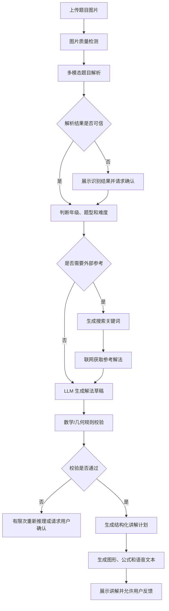

# 图片题目解析、按需检索与 LLM 讲解方案 v2

版本：v2.1  
日期：2026-09-29  
状态：MVP 方案（实施基线）

## 1. 方案结论

当前阶段不把题库沉淀作为用户请求的前置依赖。

核心目标是尽快验证以下闭环：

```text
上传题目图片
→ 图片质量检测
→ 结构化解析题目
→ ResearchRouter 判断
→ [直接解题 | 检索后解题]
→ 生成当前题目的可验证解法
→ 生成适合当前年级的生动讲解
```

题库、解法模板和向量检索暂时作为后续优化层，而不是主流程。原因：

- 题型覆盖范围尚未稳定；
- 复杂几何题很难提前设计通用模板；
- 模板沉淀需要大量人工审核和质量数据；
- 早期直接使用多模态模型和按需联网，开发成本和验证成本更低；
- 真实使用数据可以反过来决定哪些题型值得沉淀。

## 2. 目标用户流程



用户看到的核心不是“命中了哪个模板”，而是：

1. 系统识别出了什么；
2. 系统采用了什么解法；
3. 哪些内容来自外部参考；
4. 当前答案是否通过校验；
5. 用户是否需要修正题目或换一种讲法。

## 3. 核心模块

后端仍采用模块化单体，不拆微服务。第一轮只支持明确的题型范围，不能把“一般几何证明”作为坐标校验器的隐含承诺。

```text
question
  └── QuestionAnalyzer

research
  ├── ResearchRouter
  ├── SearchAdapter
  └── SourceSelector

solving
  ├── SolutionGenerator
  ├── MathVerifier
  └── GeometryVerifier

lesson
  ├── LessonPlanner
    ├── LessonRenderer
    └── LessonService

workflow
  ├── StateMachine
  ├── JobQueue
  ├── RetryPolicy
  └── Idempotency

knowledge  # 后续优化层，当前不作为主链路依赖
  ├── SolutionTemplate
  ├── TemplateMining
  └── RetrievalIndex
```

依赖方向：

```text
HTTP → Application → Domain
                   ↑
AI、搜索、数据库、队列 Adapter
```

外部调用必须通过 Adapter 隔离，并统一记录模型、Prompt 版本、请求 ID、耗时、输入输出摘要和错误信息。搜索内容属于不可信输入，不能直接拼接为系统指令或最终答案。

## 4. 题目解析模型

多模态模型的输出不能只有一段 OCR 文本，应输出统一的 `QuestionAnalysis`。该对象必须先定义 JSON Schema，再映射到内部领域模型；模型字段、数据库 JSON 和 API 字段不得各自发明一套命名。

```json
{
  "grade": 9,
  "subject": "数学",
  "type": "geometry_numeric",
  "rawText": "题目原文",
  "normalizedText": "标准化题干",
  "entities": [
    { "id": "A", "type": "point" },
    { "id": "ABCD", "type": "rectangle" }
  ],
  "relations": [
    { "type": "collinear", "points": ["E", "A", "B"] },
    { "type": "equal_length", "segments": ["AE", "AD"] },
    { "type": "intersection", "lines": ["EC", "BD"], "point": "G" }
  ],
  "knowns": [],
  "asks": [
    { "type": "prove_perpendicular", "target": ["BD", "EC"] }
  ],
  "confidence": 0.91,
  "fieldConfidence": { "text": 0.98, "diagram": 0.91, "asks": 0.88 },
  "uncertainItems": []
}
```

阶段 0 必须落地以下契约文件：

```text
docs/schemas/question-analysis.schema.json
docs/schemas/research-context.schema.json
docs/schemas/solution-draft.schema.json
docs/schemas/verified-solution.schema.json
docs/schemas/lesson-plan.schema.json
```

其中 `VerifiedSolution.validation.status` 只允许 `verified`、`needs_confirmation`、`rejected`、`unsupported`。只有 `verified` 才能进入讲解阶段。

### 4.1 普通题目

重点提取：

- 题干；
- 数字和单位；
- 已知条件；
- 问题目标；
- 公式或数量关系。

### 4.2 几何题

重点提取：

- 点、线、面和图形；
- 共线、平行、垂直、相交关系；
- 长度、角度和比例约束；
- 多个子问题及其依赖关系；
- 图形识别置信度。

几何题的模板化对象不是某个结论，而是：

```text
图形拓扑
+ 几何约束
+ 子目标依赖
+ 可行解题策略
+ 证明证据
```

## 5. 是否联网的路由策略

不建议每道题都联网。由 `ResearchRouter` 在解题前根据题目分析、题型支持范围和用户要求决定。

### 5.1 直接 LLM 解题

适用于：

- 基础计算题；
- 普通分数和方程题；
- 常见小学应用题；
- 基础几何题；
- 模型对题目结构有较高置信度。

### 5.2 联网获取参考解法

适用于：

- 复杂几何证明；
- 多问综合题；
- 竞赛或压轴题；
- 模型置信度较低；
- 需要指定年级、教材版本或教学方法；
- 用户明确要求参考网上解法。

搜索结果只作为 `ResearchContext`，不能直接作为最终答案。搜索服务暂时不可用时，可以对低风险题目回退到直接 LLM 解题，但必须记录 `research_unavailable`，不能声称使用了外部参考；用户明确要求资料或题目依赖外部参考时，应暂停并提示用户。

```json
{
  "query": "九年级 矩形 延长线 对角线 垂直 坐标法",
  "sources": [
    {
      "title": "来源标题",
      "url": "https://example.com",
      "summary": "与当前图形结构相关的解法摘要",
      "trustScore": 0.82
    }
  ],
  "retrievedAt": "2026-09-29T10:00:00Z"
}
```

### 5.3 不确定时暂停

以下情况不能静默生成确定答案：

- OCR 与图形关系冲突；
- 几何图形无法确认；
- 搜索结果之间存在明显冲突；
- LLM 结果与规则计算不一致；
- 题目超出当前求解能力。

`unsupported` 与 `needs_confirmation` 必须区分：前者表示当前能力范围不覆盖，后者表示补充信息后仍可能继续求解。

## 6. 解题与校验

LLM 负责提出解法和解释，不能单独承担正确性保证。

### 6.1 普通数学题

至少执行：

- 表达式重新计算；
- 单位检查；
- 结果代回条件；
- 多步计算中间结果检查。

### 6.2 第一轮几何题支持范围

第一轮只支持：

- 已给坐标或可以直接建立坐标系的矩形、三角形；
- 可转化为数值约束的长度、平行、垂直关系；
- 数值型目标和有限的垂直、平行、长度验证。

暂不承诺支持一般纯证明题、圆与复杂相似/全等证明、需要自由构造辅助线的题目。无法可靠建立坐标模型时必须返回 `unsupported` 或 `needs_confirmation`，不能依据图形外观猜测比例。

### 6.3 几何题校验

至少执行：

- 图形关系一致性检查；
- 坐标或向量计算；
- 长度和角度约束检查；
- 证明目标验证；
- 非退化条件检查。

结果统一为：

```json
{
  "method": "coordinate_geometry",
  "expressions": [],
  "checks": [],
  "finalAnswer": "...",
  "validation": {
    "status": "verified"
  }
}
```

只有 `verified` 的结果才能进入最终讲解。

Worker 和应用服务都必须再次检查该状态，不能只依赖 Solver 的实现约定。

## 7. 生动讲解生成

讲解生成输入：

```text
QuestionAnalysis
+ VerifiedSolution
+ 年级和学习者画像
+ 可选 ResearchContext
```

输出继续使用结构化 `LessonPlan`：

- 标题；
- 分步骤解释；
- 公式逐步展开；
- 几何图形高亮；
- 语音文本 `voiceText`；
- 易错点；
- 最终答案；
- 相似练习题。

首轮 LessonPlan 只承诺现有视觉类型和结构化步骤。几何高亮、辅助线和关系标注必须先扩展 Schema，不能依赖前端自行解释未定义字段。

不同年级采用不同讲解策略：

```text
小学：图形、分组、生活化比喻
初中：定义、定理、推理链
高中：模型、证明、边界条件
```

## 8. 题库沉淀的后置定位

题库不从主流程移除，而是降级为后台优化能力：

```text
当前：实时解析 + LLM + 按需联网
后续：高频题型缓存 + 模板复用 + 检索增强
```

只有满足以下条件，才自动生成模板候选：

- 解法已通过校验；
- 多道不同题目出现相同结构；
- 模板变量稳定；
- 用户反馈持续良好。

候选模板需要人工审核后才能发布，不能直接影响主流程。

## 9. MVP 非目标

当前阶段暂不做：

- 完整题库运营后台；
- 自动模板聚类；
- 向量数据库；
- 复杂知识图谱；
- 多服务拆分；
- 自动发布模板；
- 直接复制搜索结果作为答案。

## 10. 关键业务不变量

- 识别不确定时不能静默猜测；
- 搜索结果只能作为参考上下文；
- 未通过校验的结果不能进入 `ready`；
- 用户修正题目后必须产生新的题目版本；
- Lesson 结果必须记录使用的模型、搜索来源和校验结果；
- 同一请求重复提交不能创建多个任务；
- 外部模型失败可以重试，但用户确认和模板版本不能被旧任务覆盖；
- Worker 更新必须携带 `lessonRevision` 和 `questionVersion`，旧任务更新失败时返回 `stale_job`；
- 外部网页内容必须视为不可信输入，并限制来源、超时、大小和重定向；
- 原图、模型原始响应和外部检索内容必须有数据保留期限，不得无限期保存。

### 10.1 统一溯源记录

每次外部调用和每次阶段执行至少记录：

```text
runId、lessonId、stage、questionVersion、provider、model、promptVersion、requestId、inputHash、outputHash、latency、tokenUsage、status、errorCode
```

`ResearchContext` 需要持久化，且必须区分“模型推理”“规则校验”和“外部参考”。
